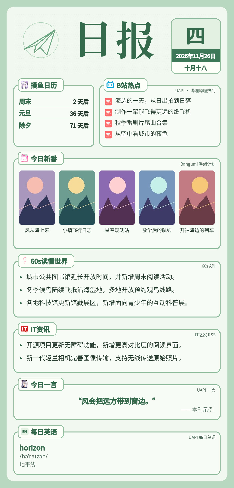

<p align="center">
  
</p>

# 美咲日报

在 AstrBot 里查阅当天的农历、节日倒计时、新番、B 站热门和新闻。日报在机器人所在服务器上生成图片，也能按文字阅读、打开来源链接，或每天自动推送到指定群聊。

<details>
<summary>查看日报卡片示例（示意内容）</summary>



</details>

## 安装

需要 **AstrBot 4.16 至 4.x**。在 AstrBot 管理面板的插件页选择通过链接安装，粘贴下方仓库地址。安装成功后，发送 `/日报` 即可。默认设置无需申请 API Key，也无需配置浏览器渲染服务。

```text
https://github.com/Whereis-Alice/astrbot_plugin_misaki_daily
```

| 命令 | 用途 |
| --- | --- |
| `/日报` | 查看当期图片。图片生成失败时，自动回复文字。 |
| `/日报文字` | 查看当期栏目和倒计时，适合文字阅读或低带宽场景。 |
| `/日报来源` | 获取当期可用的原文链接。60s 早报提供整期链接。 |
| `/日报会话` | AstrBot 管理员在接收推送的群里执行，复制返回的完整会话标识。 |

命令示例使用 `/`。如果你的 AstrBot 配置了其他唤醒前缀，请用实际前缀。

## 定时发到群聊

1. 在每个目标群里发送 `/日报会话`。
2. 打开插件设置，把返回值逐项添加到「接收推送的群聊会话标识」。完整形式类似 `onebot-main:GroupMessage:123456789`，请复制机器人返回的实际值。
3. 填写时区和每日推送时间，然后启用「群聊定时推送」并保存。默认时区为 `Asia/Shanghai`，时间为 `08:00`。

每个会话标识每天只尝试推送一次，每个目标群填一项即可。到点时请保持 AstrBot 和对应平台在线。发送超时会留下日志，避免平台已经接收时再发一份。若适配器支持主动文字但限制主动图片，可将「推送格式」设为「文字」。主动发送能力取决于 AstrBot 平台适配器，例如 QQ 官方机器人对主动发送有额外限制。

AI 问候默认关闭。开启后采用 **AstrBot 全局默认人格**的系统提示词，根据日期和节日写一句问候。模型可单独指定，留空时使用目标会话的聊天模型。问候不读取群聊历史，模型调用失败时使用固定问候。

## 栏目和数据源

| 栏目 | 数据来源 |
| --- | --- |
| 农历、周末与节日 | 本地历法计算。倒计时是自然周末或节日日期，实际放假和调休请以当地官方通知为准。 |
| 今日早报 | [60s API](https://60s.viki.moe/) 的当日简报。按日报配置时区核对日期，过期内容会跳过。 |
| 科技资讯 | [IT之家 RSS](https://www.ithome.com/rss/)，失败时尝试 UAPI 的 IT之家热榜。 |
| 今日新番 | [Bangumi 番组计划](https://bgm.tv/calendar)和近期年番标签提供候选，按当天的正片分集日期筛选。分集日期缺失时，可使用条目明确的首播日期。可关闭封面或配置 Bangumi 备用代理。 |
| B 站热门 | [UAPI](https://uapis.cn/) 的哔哩哔哩热门榜，失败时尝试 B 站热搜，卡片会标明实际来源。 |
| 今日一言 | UAPI 一言，失败时尝试 [一言](https://hitokoto.cn/)。 |
| 每日英语 | UAPI 每日单词，默认关闭，可在设置里开启。 |

条数可设为 `0` 来关闭相应栏目。默认缓存 20 分钟，命令和定时推送共用当期数据。新番列表受 Bangumi 的分集日期和年番标签覆盖影响。源站失败时会在对应栏目提示，其他栏目照常生成。

**UAPI Token 可以留空。** B 站热门、一言、每日英语和 IT 热榜后备均可走访客额度。遇到访客限流时，可把自己的 API Key 填到插件设置的「UAPI Token（可选）」。[UAPI 密钥管理](https://uapis.cn/console/api-keys) · [限流说明](https://uapis.cn/docs/getting-started/fair-use-and-rate-limiting)

### 卡面立绘

首次生成图片时，插件会从 sprite 的官方图源加载鸢泽美咲校服立绘，裁成半身显示，并在本地缓存原图。服务器第一次取图失败时，报头会暂用纸飞机，下次可以重新获取。[官方角色页](https://sprite.net/characters/misaki) · [官方立绘](https://framerusercontent.com/images/d1XMAcN3f16oO52zqizH1IxYW4.webp)

自定义时，把透明背景的 WebP 半身图保存到 AstrBot 的 `data/plugin_data/astrbot_plugin_misaki_daily/portrait.webp`，然后重载插件。它会优先用于卡面。

## 从真寻日报切换

两款插件都注册了 `/日报`。迁移时可停用原插件。如果同时使用，可以在 AstrBot 的「插件管理 → 管理行为 → 指令」中找到对应插件，将其中一条 `/日报` 重命名或禁用。定时推送由各插件单独控制。

原配置中的裸群号请用 `/日报会话` 重新获取完整值。新版使用上表中的数据源，旧 ALAPI Token 可以省去。

## 许可与致谢

- 代码基于 AGPL-3.0 发布。美咲日报由真寻日报独立衍生，六个原版栏目图标沿用上游资源。感谢原作者 Huahuatgc、维护者 luminacry，以及更早的 NoneBot 日报项目。[许可证](LICENSE) · [上游基线](https://github.com/luminacry/astrbot_plugin_zhenxunribao/tree/08169bec0a4032bf9af2e41fd544d1912a4f607d) · [nonebot-plugin-zxreport](https://github.com/HibiKier/nonebot-plugin-zxreport)
- 内置 Noto Sans SC 及用于英语音标的 Noto Sans 子集均使用 SIL Open Font License 1.1。[Noto Sans SC 许可](assets/OFL.txt) · [Noto Sans 许可](assets/OFL-NotoSans.txt)
- 刊头使用 Noto Serif SC 的两字子集，依据 SIL Open Font License 1.1 分发。[刊头字体许可](assets/OFL-DailyMasthead.txt)
- 美咲日报是非官方插件。鸢泽美咲出自 sprite 的游戏《苍之彼方的四重奏》，角色相关权利归原权利人。[官方角色页](https://sprite.net/characters/misaki) · [二次创作指南](https://sprite.net/pages/guidelines)

遇到异常时，欢迎附上 AstrBot 版本、适配器名称、执行的命令和相关日志。发布前请从日志里移除令牌、群聊标识和代理账号。[提交 Issue](https://github.com/Whereis-Alice/astrbot_plugin_misaki_daily/issues/new)
